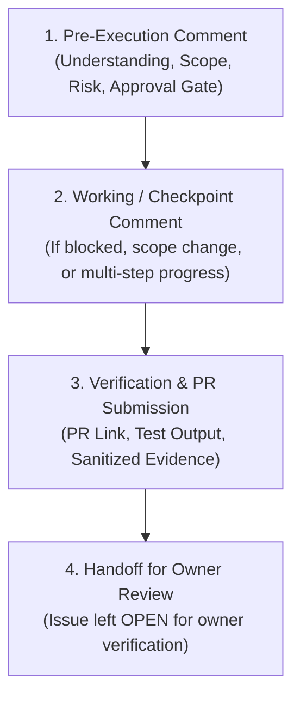

# Antigravity & Agent Execution Protocol (AGENT_PROTOCOL.md)

> **Canonical specification governing AI agent and human engineer collaboration across GitHub issues, branches, pull requests, host modifications, and infrastructure lifecycle operations for VexterSoft.**

---

## 1. Core Principles & Single Source of Truth
1. **GitHub is the Durable Record:** Every non-trivial task, decision, architectural change, host state mutation, and review handoff must be anchored to a GitHub Issue and Pull Request.
2. **Zero Unverified Claims:** Agents must distinguish clearly between *planned*, *attempted*, and *empirically verified* operations. Never declare an operation complete without providing sanitized terminal execution evidence.
3. **Defense in Depth & Zero Lockout:** Host mutations that affect SSH, firewalls, network interfaces, or container routing must follow strict pre-validation gates (dual-session proof, emergency console recovery verification).
4. **Zero-Secret Invariant:** Secrets, private keys, tokens, passwords, and tunnel credentials must NEVER be placed in Git repositories, issues, PR descriptions, review comments, or logs. If an exposure occurs: stop immediately, do not repost or quote the secret, notify the repository owner, and recommend credential rotation.

---

## 2. Risk Classification System

Every issue, task, and playbook must declare its explicit risk class:

| Risk Class | Definition & Scope | Approval Requirement | Execution Constraints |
| :--- | :--- | :--- | :--- |
| **`READ-ONLY`** | Diagnostic inspection, status checks, non-mutating queries (`uname`, `ss`, `git status`). | Self-authorized. | May execute concurrently with offline tasks. |
| **`LOCAL-REPO`** | Code, tests, Ansible playbooks, templates, and documentation changes in local workspace. | Self-authorized. | Zero host mutation allowed. |
| **`HOST-CHANGE`** | Package installation, user/group changes, SSH daemon reconfiguration, UFW/iptables rules, swap allocation, Docker engine installation, systemd restarts. | **Explicit Owner Approval required in GitHub Issue** before execution. | Strictly serialized: only ONE host-changing task at a time per VPS. |
| **`PRODUCTION-DESTRUCTIVE`** | Production cutovers, DNS migrations, persistent volume removal, database restores, or any change with risk of lockout/data loss. | **Explicit Owner Approval naming exact target & operation**. | Must provide validated rollback script and test proof before execution. |

> [!CAUTION]
> Assignment of an issue, general plan review, silence, or generic messages such as *"continue"* do **NOT** constitute approval for a `HOST-CHANGE` or `PRODUCTION-DESTRUCTIVE` operation. Approval must be explicitly stated.

---

## 3. Git Branching & PR Lifecycle

1. **Branch Naming:**
   - Tasks must be developed on a dedicated branch following the pattern:
     ```bash
     agent/issue-<number>-<short-slug>
     ```
   - Example: `agent/issue-1-github-agent-protocol`
2. **Commits:**
   - Commit messages must be structured and reference the issue number:
     ```
     feat(protocol): establish agent-github execution protocol (#1)
     ```
3. **Pull Requests:**
   - Material code and configuration changes must be submitted via Pull Request targeting `main`.
   - PR description must include: Rationale, Scope, Changed files, Test & verification evidence, Security impact, Manual steps, Rollback plan, and Acceptance criteria checklist.
   - **Do not merge or close issues unilaterally.** The agent opens the PR and posts completion evidence on the issue, leaving the final merge and issue closing for repository owner review. Use `Closes #N` only when the issue is 100% complete.

---

## 4. Issue Lifecycle & Communication Protocol

The agent must provide four standard lifecycle comments on each assigned GitHub Issue:



### A. Pre-Execution Comment (Before starting work)
Before executing commands or making edits, post a status comment detailing:
- Current Status: `In Progress`
- Declared Risk Class
- Working Branch
- Understanding of requirements and dependencies (DAG)
- Planned files to touch and host actions to execute
- Applicable approval gates

### B. Blocked / Checkpoint Comment
If unexpected errors arise, prerequisites are missing, or scope diverges, post immediately describing the blocker, proposed resolution options, and wait for human owner direction.

### C. Completion Comment (Before review handoff)
Upon completing implementation and verification:
- PR link and commit hashes
- Exact verification commands executed and raw outputs (sanitized of sensitive info)
- Verified host state changes (if applicable)
- Rollback and recovery instructions
- Residual risks and next unblocked DAG tasks

---

## 5. Host Safety & Infrastructure Invariants

For all host operations on the Contabo VPS (`5.189.128.157` / Ubuntu 24.04.5 LTS):

1. **OS Preservation:** Never reinstall the operating system without explicit owner approval.
2. **Dual-Session SSH Gate:**
   - Before disabling root password login or restarting `sshd`:
     1. Create non-root sudoer user with public key authorized.
     2. Open a **second, independent SSH session** authenticated via the key and prove passwordless `sudo` execution.
     3. Keep the initial session open until secondary key login is proven.
     4. Document Contabo Web VNC/Rescue Console access procedures.
3. **Zero Management Exposure:**
   - Portainer CE, Docker socket/APIs, PostgreSQL clusters, and internal services MUST NOT be exposed on public host interfaces (`0.0.0.0` or `[::]`).
   - Management access (`devops.vextersoft.com`) must be routed strictly via an outbound Cloudflare Tunnel protected by Cloudflare Access and Portainer native credentials.
   - Client-facing applications (Odoo 20, ZelixVet) must be routed via public Cloudflare Tunnel hostnames with standard TLS, **without** forcing client users through Cloudflare Access Zero Trust authentication.
4. **IPv4 & IPv6 Firewall Parity:**
   - UFW / Netfilter rules must explicitly address both IPv4 and IPv6 traffic.
   - Account for Docker's default bypass of UFW `iptables` chains by configuring Docker daemon iptables integration or explicit loopback binding.
5. **Multi-Environment Isolation:**
   - Production, Staging, and Marketing Demo instances must reside on distinct Docker networks with isolated persistent volume mounts and separate database credentials. Demo environments must strictly use synthetic data.
