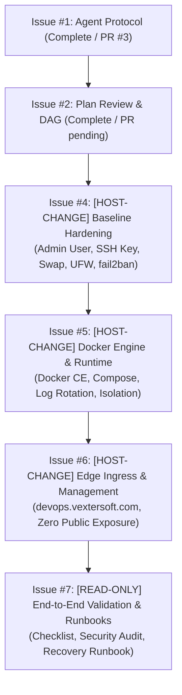

# VexterSoft VPS Bootstrap Plan Review & Execution DAG

**Status:** Completed Review & Execution Plan
**Target Host:** Contabo Cloud VPS 6 (`vmi3682629` / `<TARGET_HOST_IP>`)
**Operating System:** Ubuntu 24.04.5 LTS (Noble Numbat), Kernel `6.8.0-139-generic x86_64`
**Reference Issues:** Refers to GitHub Issue #2

---

## 1. Review of Initial Plan Against Inspection Findings

### A. SSH Hardening & Lockout Prevention
- **Finding:** Currently, `root` password login on port 22 is active with no rate limiting.
- **Deficiency in Initial Plan:** The initial plan did not mandate a verified secondary session before altering SSH daemon settings.
- **Remediation Specification:**
  1. Create administrative user `vexteradmin` with membership in `sudo`.
  2. Install administrative SSH public key to `/home/vexteradmin/.ssh/authorized_keys` with `chmod 600`.
  3. **Mandatory Validation Gate:** Establish a secondary SSH connection using the key and test `sudo -n true`.
  4. Only after secondary session verification, configure `/etc/ssh/sshd_config.d/99-hardening.conf` setting:
     - `PermitRootLogin prohibit-password`
     - `PasswordAuthentication no`
     - `KbdInteractiveAuthentication no`
     - `MaxAuthTries 4`
  5. Validate syntax with `sshd -t` before reloading the service via `systemctl reload ssh`.
  6. Verify third login via key while maintaining active primary session.

### B. UFW Firewall & Docker Netfilter Interaction
- **Finding:** UFW is currently inactive, and iptables policy is `ACCEPT` on all chains.
- **Deficiency in Initial Plan:** Docker by default manipulates `iptables` directly (via its `PREROUTING` and `DOCKER` chains), which completely bypasses standard UFW `INPUT` filter rules for published ports (`-p 8080:8080`).
- **Remediation Specification:**
  1. Configure `/etc/default/ufw` with `IPV6=yes` to enforce policy across both IPv4 and IPv6 public interfaces.
  2. Default policies: `ufw default deny incoming`, `ufw default allow outgoing`.
  3. Allow SSH: `ufw allow 22/tcp comment 'SSH Administrative Access'`.
  4. **Strict Docker Port Rule:** Never publish management or database ports to `0.0.0.0` or `[::]`. Any exposed port in Docker Compose must bind strictly to loopback (e.g., `127.0.0.1:9000:9000`) or communicate solely via internal Docker networks routed through Cloudflare Tunnel.

### C. Swap Sizing & Virtual Memory Tuning
- **Finding:** 11 GiB RAM with 0 B swap.
- **Remediation Specification:**
  1. Create a 4 GiB swapfile at `/swapfile` using `fallocate -l 4G /swapfile` (or `dd` if sparse is unsupported), `chmod 600`, `mkswap`, and `swapon`.
  2. Persist in `/etc/fstab`.
  3. Tune memory subsystem in `/etc/sysctl.d/99-vps-tuning.conf`:
     - `vm.swappiness = 10` (prefers RAM; uses swap only to avoid OOM crashes)
     - `vm.vfs_cache_pressure = 50`

### D. Disk & Container Log Safeguards
- **Finding:** The root partition `/dev/sda1` has 191 GB free. Without log rotation, high-volume container logs (Odoo, PostgreSQL, web traffic) can exhaust disk inodes or space.
- **Remediation Specification:**
  1. Configure `/etc/docker/daemon.json` globally:
     ```json
     {
       "log-driver": "json-file",
       "log-opts": {
         "max-size": "20m",
         "max-file": "5"
       }
     }
     ```
  2. Cap systemd journal in `/etc/systemd/journald.conf.d/99-limit.conf`: `SystemMaxUse=1G`.

### E. Dual-Tier Cloudflare Routing Architecture
- **Zero Inbound Management Exposure:** Portainer and internal database services will NOT listen publicly.
- **Tier 1 (Internal DevOps Management):**
  - Hostname: `devops.vextersoft.com`
  - Ingress: Outbound encrypted Cloudflare Tunnel (`cloudflared`) -> Portainer CE internal port (`9000`).
  - Edge Protection: Cloudflare Access Zero Trust policy (SSO/email OTP) + Portainer native user credentials.
- **Tier 2 (Public Multi-Tenant Client Applications):**
  - Hostnames: `odoo.vextersoft.com`, `zelixvet.tomkenvet.ca`, `demo.vextersoft.com`.
  - Ingress: Outbound Cloudflare Tunnel -> Internal application container ports (`8069`, `8000`, etc.).
  - Edge Protection: Public Cloudflare CDN/TLS, WAF, and DDoS mitigation — **no Cloudflare Access Zero Trust wall for external users**.

---

## 2. Platform Bootstrap Dependency DAG



---

## 3. Atomic Follow-Up Task Specifications

### Task 1: Baseline Hardening (Issue #4)
- **Risk Class:** `HOST-CHANGE`
- **Approval Gate:** Requires explicit owner approval on Issue #4 and owner-supplied SSH public key.
- **Key Deliverables:** Ansible playbook `ansible/playbooks/01-baseline-hardening.yml`, user `vexteradmin`, 4 GB swap, UFW IPv4/IPv6, fail2ban, SSH key enforcement.
- **Validation:** Dual-session SSH key test, UFW status verification, memory swap verification.
- **Rollback:** `sudo ufw disable && sudo rm -f /etc/ssh/sshd_config.d/99-hardening.conf && sudo systemctl reload ssh` (primary session kept alive; emergency rescue console procedure documented).

### Task 2: Container Runtime Installation (Issue #5)
- **Risk Class:** `HOST-CHANGE`
- **Approval Gate:** Requires explicit owner approval on Issue #5.
- **Key Deliverables:** Ansible playbook `ansible/playbooks/02-docker-engine.yml`, official Docker repository setup, Docker CE 27.x, Compose plugin, `/etc/docker/daemon.json` log limits.
- **Validation:** `docker run --rm hello-world`, log limit inspection, `docker compose version`.
- **Rollback:** `sudo systemctl stop docker docker.socket && sudo apt-get remove -y docker-ce docker-ce-cli containerd.io docker-compose-plugin` (DO NOT delete `/var/lib/docker` during routine rollback; volume destruction is separately gated).

### Task 3: Edge Ingress & Management Deployment (Issue #6)
- **Risk Class:** `HOST-CHANGE`
- **Approval Gate:** Requires Cloudflare Tunnel token in `.env` and explicit owner approval on Issue #6.
- **Key Deliverables:** Ansible playbook `ansible/playbooks/03-cloudflared-portainer.yml`, `cloudflared` container, Portainer CE container bound to internal bridge network, Cloudflare Tunnel ingress configuration for `devops.vextersoft.com`.
- **Validation:** Tunnel health query, Portainer internal ping, `ss -tulpn` proving port 9000 is NOT listening on `0.0.0.0` or `[::]`.
- **Rollback:** `cd /opt/vextersoft/management && docker compose stop` (DO NOT pass `-v` to avoid deleting persistent volumes; volume destruction is separately gated).

### Task 4: End-to-End Validation & Disaster Recovery Runbook (Issue #7)
- **Risk Class:** `READ-ONLY` / `LOCAL-REPO`
- **Approval Gate:** Self-authorized.
- **Key Deliverables:** Comprehensive operational test suite `scripts/verify_platform.py`, `docs/recovery-runbook.md`, updated `README.md`.
- **Validation:** 100% automated test pass rate for network isolation, firewall state, and service health.
